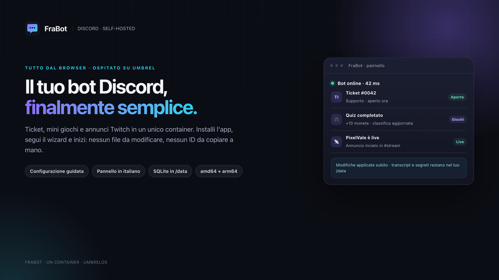

# FraBot

Bot Discord **self-hosted** con pannello web in italiano, distribuito come app Docker per
**UmbrelOS** tramite un community app store.

Un solo container: `discord.py` e FastAPI/uvicorn nello stesso processo, SQLite in `/data`,
frontend vanilla senza build step. Si configura interamente dal browser: nessun file da
modificare e nessuna variabile d'ambiente da impostare a mano.



## Cosa include

- **Wizard iniziale in 7 passaggi**: app Discord, verifica del token, link di invito,
  controllo che il bot sia davvero nel server, scelta del server, moduli, Twitch e
  messaggio di prova. Lo stato viene salvato e il wizard è rilanciabile da Impostazioni.
- **Ticket**: pannello con pulsanti persistenti, categorie con canale Discord e ruoli staff,
  canali privati `ticket-0001-nome`, presa in carico, aggiunta di utenti, limite per utente,
  chiusura automatica per inattività, transcript HTML nel canale log e in DM.
- **Mini giochi**: Tris, Indovina il numero, Quiz, Pietra-carta-forbice, moneta/dadi e slot.
  Economia virtuale opzionale (`daily`, saldo, classifica), cooldown e premi configurabili,
  editor del quiz con import/export JSON e classifiche azzerabili.
- **Annunci Twitch**: polling di Helix ogni 60 secondi, fino a 100 login per richiesta,
  app access token rinnovato automaticamente, deduplica tramite ID dello stream, menzione
  e template per streamer, modifica dell'annuncio a fine diretta, anteprima e test dal pannello.
- **Pannello**: Dashboard, Ticket, Mini giochi, Twitch, Impostazioni e Log. Salvataggi con
  toast, errori in italiano, backup/import della configurazione, colore degli embed,
  aggiornamento del token e reset.
- **Sicurezza operativa**: nessun intent privilegiato `Message Content`, comandi admin con
  `default_member_permissions`, segreti mascherati nelle API e rimossi dai log, CSP e
  protezione CSRF per le chiamate che modificano dati.

## Installazione su Umbrel

Requisiti: umbrelOS con Docker e accesso all'App Store. Il bot Discord e, se vuoi gli annunci
live, un'app Twitch sono sufficienti; non serve esporre nulla su Internet.

FraBot è nello store community **Gigio & Dany**:

1. Apri **App Store**.
2. Menu **⋯** in alto a destra → **Community App Stores** → **Add community app store**.
3. Incolla `https://github.com/Gigiomiccio425/Gigio-dany-appstore`.
4. Installa **FraBot** e apri l'app: il pannello passa dal login di Umbrel tramite
   `app_proxy`.
5. Segui il wizard. Alla fine il bot invierà un messaggio di prova nel canale scelto.

La porta esterna è **8417**, poco comune e libera nello store (la 8080 è già usata da GD AMP);
il container ascolta internamente sulla 8080. L'app non espone porte direttamente sull'host:
l'unica porta del pannello è gestita da `app_proxy` e protetta dalla sessione Umbrel. Per pubblicare uno
store tuo, vedi il pacchetto standalone più sotto.

### Primo avvio

Servono un account Discord e i permessi di amministratore su un server. Nel wizard:

1. **App Discord** — crea l'applicazione dal
   [Developer Portal](https://discord.com/developers/applications), copia **Application ID**
   e **Bot Token**. FraBot li verifica chiamando Discord prima di salvarli.
2. **Invito** — il pannello genera il link OAuth2 con gli scope `bot` e
   `applications.commands` e i soli permessi necessari. Dopo l'invito, il pulsante di
   controllo verifica la presenza del bot nel server.
3. **Server e moduli** — scegli il server (se il bot è in più di uno) e attiva Ticket,
   Mini giochi e Annunci Twitch. Canali e ruoli sono menu a tendina letti da Discord.
4. **Twitch** (facoltativo) — crea un'app su [dev.twitch.tv](https://dev.twitch.tv/console/apps)
   e incolla Client ID e Client Secret. Il pulsante di test esegue una vera richiesta
   Client Credentials.
5. **Riepilogo** — controlla tutto e invia il messaggio di prova.

## Pubblicare nello store Gigio & Dany

FraBot è distribuito nello store community
[**Gigio & Dany**](https://github.com/Gigiomiccio425/Gigio-dany-appstore). Lo store contiene
solo manifest e compose; il codice e l'immagine vivono in questo repository.

- Sorgente e workflow: `https://github.com/danyx67800/frabot`
- Immagine: `ghcr.io/danyx67800/frabot`
- App nello store: `g-d-app-store-gd-frabot` (porta esterna **8417**, interna **8080**)

Per pubblicare una nuova versione:

1. Aggiorna la versione in `app/__init__.py` (e, se usi anche il pacchetto standalone, in
   `frabot-frabot/umbrel-app.yml`).
2. Commit e push su `main`; crea e pubblica il tag `v1.0.1`.
3. Attendi il workflow **Publish Docker image** e verifica
   `ghcr.io/danyx67800/frabot:1.0.1`.
4. Nello store aggiorna `version` in `g-d-app-store-gd-frabot/umbrel-app.yml` e il tag
   dell'immagine in `g-d-app-store-gd-frabot/docker-compose.yml`; aggiorna `releaseNotes`.
5. Commit e push dello store: Umbrel mostrerà l'aggiornamento.

Il workflow costruisce `linux/amd64` e `linux/arm64` e pubblica i tag `1.0.1`, `1.0`, `latest`
e lo SHA. Il pacchetto GHCR deve essere pubblico: se resta privato, Umbrel non può scaricare
l'immagine (GitHub → **Packages** → `frabot` → **Package settings** → **Change visibility** →
**Public**).

### Pacchetto standalone (opzionale)

La cartella `frabot/` è anche la radice di un community app store autonomo, per chi vuole
pubblicarne uno proprio:

```text
umbrel-app-store.yml          # id e nome dello store
frabot-frabot/                # app id = frabot-frabot
  umbrel-app.yml              # manifest, porta, descrizione, gallery
  docker-compose.yml          # app_proxy + prepara + web, volume ${APP_DATA_DIR}/data
  icon.svg
  gallery/1.png … 3.png
Dockerfile                    # immagine python:3.12-slim, utente non-root
app/                          # bot, API, database, servizi
static/                       # pannello vanilla
.github/workflows/            # build multi-arch e push su GHCR
```

Il manifest e il compose contengono il segnaposto `OWNER`. GitHub Actions pubblica su
`ghcr.io/<owner>/frabot`; per rendere coerenti anche le URL di icona/gallery e l'immagine
del compose usa lo script incluso:

```bash
python3 tools/configure_store.py TUO_UTENTE 1.0.0
```

Poi:

```bash
git init
git add .
git commit -m "FraBot 1.0.0"
git branch -M main
git remote add origin git@github.com:TUO_UTENTE/frabot.git
git push -u origin main
git tag v1.0.0
git push origin v1.0.0
```

Il workflow **Publish Docker image** costruisce `linux/amd64` e `linux/arm64` e pubblica i
tag `1.0.0`, `1.0`, `latest` e lo SHA. Al primo push:

1. Apri la pagina del repository su GitHub → **Actions** e attendi la fine del workflow.
2. Vai su **Packages** → `frabot` → **Package settings** → **Change visibility** →
   **Public**. Se il pacchetto resta privato, Umbrel non può scaricare l'immagine.
3. Verifica che esistano `ghcr.io/TUO_UTENTE/frabot:1.0.0` e `:latest`.
4. Aggiungi lo store in Umbrel usando l'URL del repository.

Il repository deve essere pubblico: Umbrel legge direttamente `umbrel-app-store.yml` e il
manifest via GitHub.

### Aggiornare il pacchetto standalone

1. Aggiorna il codice.
2. Aggiorna versione, manifest e tag dell'immagine con lo stesso script:
   `python3 tools/configure_store.py TUO_UTENTE 1.0.1`
3. Aggiorna `releaseNotes` in `frabot-frabot/umbrel-app.yml`, commit e push.
4. Crea e pubblica il tag `v1.0.1`; attendi il workflow GHCR.
5. In Umbrel apri lo store, aggiorna i metadati e installa l'aggiornamento dell'app.

L'immagine nel compose è volutamente fissata alla versione del manifest: un aggiornamento
di Umbrel non cambia codice senza che il manifest sia stato aggiornato.

## Sviluppo locale

Non serve Node, né un build step: il frontend è HTML/CSS/JS vanilla servito da FastAPI.

```bash
python3.12 -m venv .venv
source .venv/bin/activate
pip install -r requirements.txt
FRABOT_DATA_DIR=./data-dev uvicorn app.main:app --host 127.0.0.1 --port 8080
```

Apri `http://127.0.0.1:8080`. Il database di sviluppo viene creato in `data-dev/`; non usare
questa cartella in produzione.

Test rapido:

```bash
curl -s http://127.0.0.1:8080/health
curl -s http://127.0.0.1:8080/api/status
```

### Docker Compose locale

```bash
docker build -t frabot:local .
docker compose up -d
curl -s http://127.0.0.1:8080/health
docker compose logs -f
```

Il compose locale (`docker-compose.yml` nella radice) espone il pannello solo su
`127.0.0.1:8080` e usa il volume `./data`. Il compose Umbrel è separato e non espone porte.

### Test manuale del pannello

Senza un token Discord reale il bot resta disconnesso, ma puoi provare:

- wizard (i passaggi che non richiedono Discord),
- CRUD categorie ticket, quiz e streamer,
- export/import della configurazione,
- log strutturati, filtri e aggiornamento automatico,
- anteprima degli annunci Twitch.

I test end-to-end su Discord e Twitch richiedono credenziali reali e un server di prova.

## Configurazione e dati

Tutto ciò che è configurabile sta in `/data`:

```text
/data/frabot.db          # SQLite in modalità WAL: configurazione, ticket, economia, quiz
/data/transcripts/       # transcript HTML dei ticket chiusi
```

Non ci sono variabili d'ambiente obbligatorie oltre a `FRABOT_DATA_DIR` (impostata dal
compose a `/data`). Il token Discord e il Client Secret Twitch sono salvati nel database,
non in file `.env`; non vengono mai restituiti al browser e vengono rimossi dai log. Il
pannello è protetto dal login di Umbrel: se lo esponi fuori da Umbrel, mettilo dietro un
reverse proxy con autenticazione.

**Backup**: da Impostazioni puoi esportare la configurazione in JSON. L'export non contiene
token, secret, Application ID, ID server né messaggi del pannello. Per un backup completo
copia il volume dell'app (database e transcript); il database contiene anche i segreti,
quindi trattalo come tale.

**Reset**: “Azzera configurazione” cancella token, moduli, categorie, quiz e streamer, ma
lascia ticket e transcript nel volume.

## Scelte e ambiguità

- **Transcript senza Message Content.** Il vincolo di non usare l'intent privilegiato rende
  impossibile leggere il testo dei messaggi scritti dai membri nei canali del server. Il
  transcript HTML conserva quindi metadati, allegati, embed e messaggi del bot, e mostra un
  segnaposto esplicito al posto del testo dei membri. L'alternativa sarebbe richiedere
  l'intent privilegiato, che il progetto non fa.
- **Autenticazione delegata a Umbrel.** `app_proxy` applica il login di Umbrel; il container
  non espone porte e non duplica un sistema di account. Le API di modifica richiedono inoltre
  l'header `X-Requested-With: FraBot`, che un form cross-site non può impostare.
- **Segreti nel database.** Per rispettare il requisito “niente variabili d'ambiente a mano”,
  token e secret sono nel DB in `/data`, mascherati nelle risposte API e filtrati nei log.
- **Polling Twitch, non webhook.** Un'installazione Umbrel non è esposta pubblicamente e non
  ha un URL stabile: il polling ogni 60 secondi è la soluzione più semplice e non richiede
  port forwarding. La deduplica usa l'ID dello stream, quindi un riavvio non duplica gli
  annunci.
- **Un solo container.** Bot, API, scheduler della chiusura ticket e polling Twitch vivono
  nello stesso processo. Non servono Redis, Celery o un database esterno.
- **Porta 8417 esterna, 8080 interna.** Nello store Gigio & Dany il manifest dichiara 8417,
  una porta poco comune scelta per non collidere con le altre app dello store né con i servizi
  HTTP più diffusi; `APP_PORT` di `app_proxy` resta 8080, dove ascolta uvicorn. Anche il
  pacchetto standalone usa 8417. Il compose locale mappa 8080 per comodità.
- **Due app id.** Nello store Gigio & Dany l'app è `g-d-app-store-gd-frabot` (lo store id è
  `g-d-app-store`); il pacchetto standalone usa invece `frabot-frabot`, perché il suo store id
  è `frabot`. In entrambi i casi la cartella deve chiamarsi come l'app id, perché è anche il
  prefisso di `APP_HOST`. Il nome visibile resta “FraBot”.
- **Giochi in memoria.** Le sessioni di gioco attive non sopravvivono a un riavvio; i dati
  persistenti (saldi, statistiche, quiz) sono nel DB. Le view dei ticket sono invece
  persistenti e vengono ricostruite all'avvio.
- **Immagini della gallery.** Sono generate da `assets/gallery.html`; lo store Gigio & Dany
  usa URL raw GitHub con owner `danyx67800`, mentre il pacchetto standalone usa il segnaposto
  `OWNER` e lo script di configurazione.

## Struttura del codice

```text
app/
  main.py              FastAPI, security headers, static, lifespan
  runtime.py           avvio/stop di bot, database, scheduler e Twitch
  config.py            schema configurazione, default, validazione, mascheramento
  db/                  SQLite WAL, schema, migrazioni leggere
  bot/
    client.py          client Discord e supervisione riconnessione
    manager.py         ciclo di vita del bot
    cogs/tickets.py    pannello, view persistenti, transcript, auto-close
    cogs/games.py      slash command, economia, quiz, classifiche
  services/
    discord_api.py     verifica token/app, guild, canali, ruoli
    twitch_api.py      client credentials, Helix /streams e /users
    twitch_monitor.py  polling, deduplica, annunci
    transcripts.py     HTML sanificato
    config_io.py       export/import/reset
  web/                 API REST e validazione input
static/                pannello: HTML, CSS, JS, i18n/it.json
frabot-frabot/         pacchetto Umbrel standalone
tools/                 helper per il pacchetto standalone
```

Il manifest e il compose usati dallo store Gigio & Dany vivono nell'altro repository
(`Gigiomiccio425/Gigio-dany-appstore`, cartella `g-d-app-store-gd-frabot/`).

## Verifiche eseguite

- `docker build` dell'immagine finale completato; container avviato con healthcheck `healthy`,
  utente non-root `frabot`, `/health` `200` con database `ok`.
- API provate su container: stato, protezione CSRF (403 senza header), CRUD categorie/quiz,
  export della configurazione e scrittura del database in `/data`.
- Frontend: `node --check` su tutti i file JS, i18n JSON valido, pannello e asset serviti.
- Manifest e compose dello store validati: id, campi richiesti, `APP_HOST` e assenza di
  conflitti di porta (FraBot su 8417).
- Pannello e wizard ispezionati nel browser; layout responsive, tema scuro, i18n italiano.
- Build multi-arch eseguita su GitHub Actions: l'immagine
  `ghcr.io/danyx67800/frabot:1.0.0` è pubblica per `linux/amd64` e `linux/arm64`.

I test con Discord e Twitch reali non sono stati eseguiti in questo ambiente perché non
esistono credenziali e un server di prova: il wizard li richiede espressamente e li valida
contro le API ufficiali al primo utilizzo.
